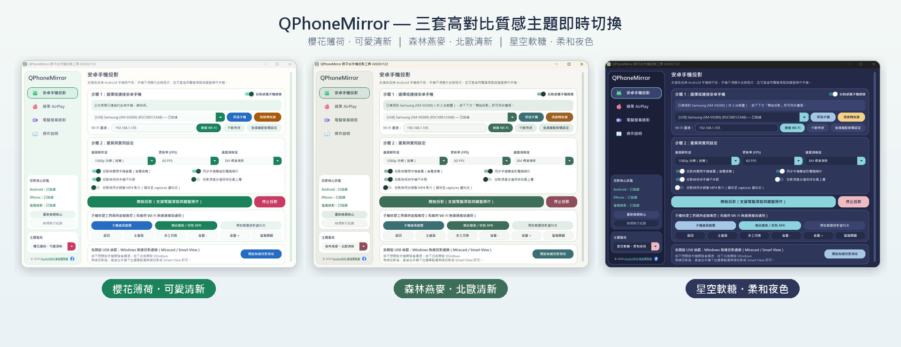
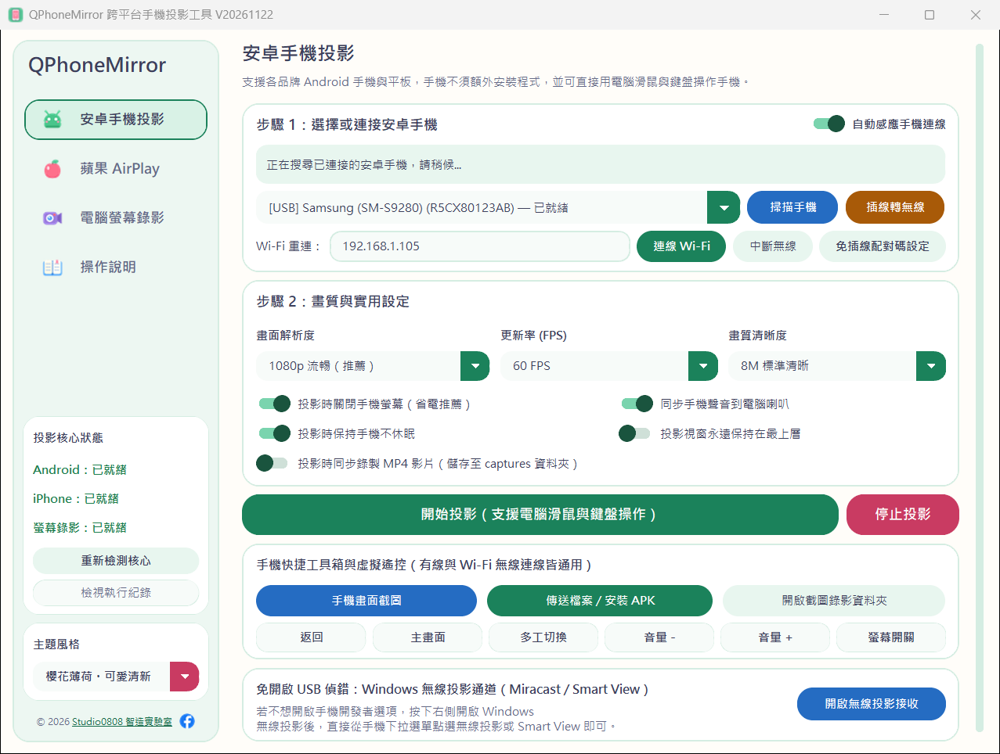
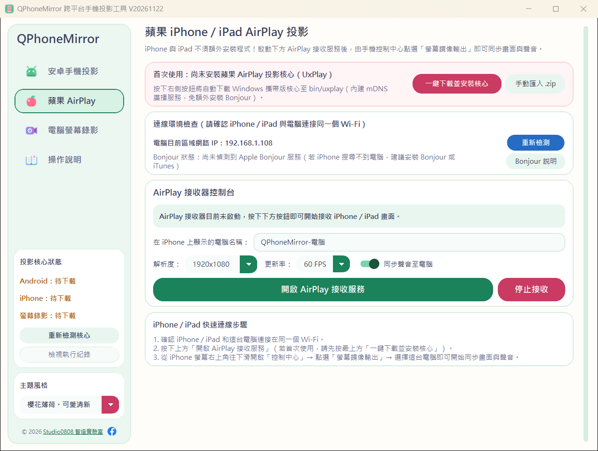
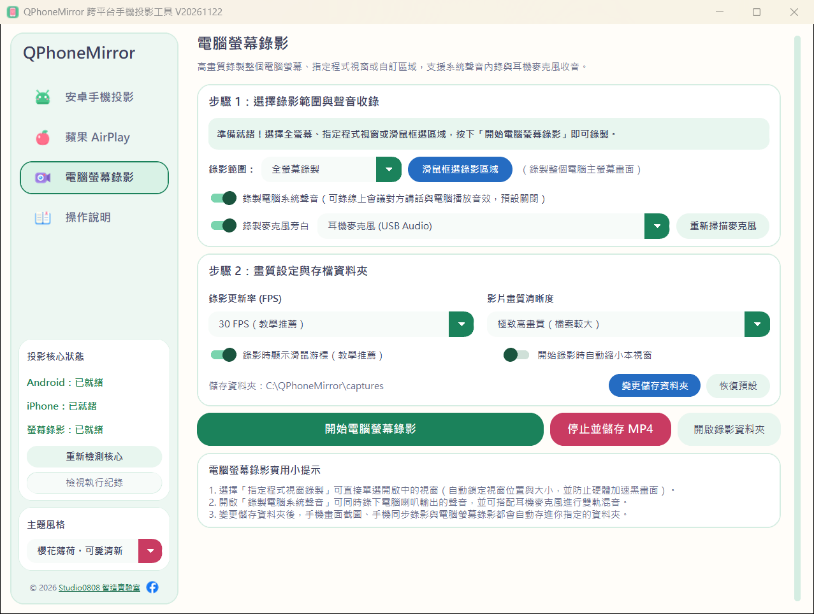
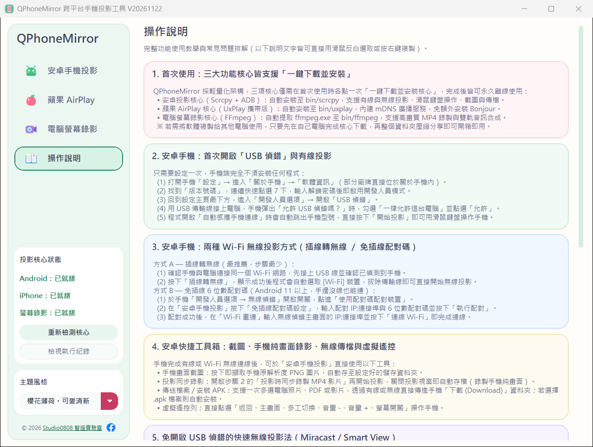

# QPhoneMirror

[-0078D6?style=flat-square)](https://github.com/begin0808/QPhoneMirror/releases)
[](https://www.python.org/)
[](LICENSE)
[](https://github.com/begin0808/QPhoneMirror/releases)

**QPhoneMirror** 是一款專為 Windows 設計的**免費、開源、免安裝、100% 台灣繁體中文**跨平台手機投影與高畫質電腦螢幕錄影工具。

- **完全免費、無廣告、無浮水印、手機端不須安裝任何 App**
- **一鍵自動下載核心**：首次使用時一鍵從官方 GitHub 下載對應開源核心（Scrcpy / UxPlay / FFmpeg），完成後即可永久離線使用
- **三套高對比主題即時切換**：櫻花薄荷・可愛清新 ／ 森林燕麥・北歐清新 ／ 星空軟糖・柔和夜色（全介面按鈕與文字皆達 WCAG ≥ 4.5:1 清晰對比）



---

## 介面實景預覽

| 安卓手機投影（USB ＋ Wi-Fi 無線） | 蘋果 AirPlay（一鍵下載免裝 Bonjour） |
| :---: | :---: |
|  |  |
| **高畫質電腦螢幕錄影（系統音＋麥克風雙軌）** | **內建 8 大章節操作說明（支援反白複製）** |
|  |  |

---

## 核心功能一覽

### 1. 安卓手機投影（Android USB ＋ Wi-Fi 無線）
- **有線即插即用**：自動感應手機連線，投影同時支援電腦滑鼠與鍵盤直接操控手機，支援 Android 11+ 原生音訊同步與投影時關閉手機實體螢幕省電。
- **兩種 Wi-Fi 無線投影**：
  - **插線轉無線**：USB 接上後一鍵切換 Wi-Fi 無線 ADB，拔線即可無線操作。
  - **免插線 6 位數配對碼（Android 11+）**：手邊沒傳輸線也能直接配對連線。
- **快捷工具箱與虛擬遙控**：一鍵擷取原解析度 PNG 截圖、投影時同步錄製 MP4（支援優雅結束完整寫入檔尾）、有線／無線批次傳送檔案至手機 `Download` 資料夾與自動安裝 `.apk`、虛擬導航鍵（返回／主畫面／多工切換／音量／螢幕開關）。
- **免開啟 USB 偵錯備援通道**：一鍵喚起 Windows 原生無線投影（Miracast / Smart View）。

### 2. 蘋果 iPhone / iPad AirPlay 無線投影
- **一鍵安裝免裝 Bonjour 的攜帶版核心**：自動由開源專案下載 Windows 64 位元攜帶版 AirPlay 接收器（內建 mDNS 廣播服務，免額外安裝 Apple Bonjour 或 iTunes），亦支援手動匯入 `.zip`。
- **操作超直覺**：啟動接收服務後，於 iPhone / iPad 控制中心點選「螢幕鏡像輸出」即可同步畫面與聲音。

### 3. 高畫質電腦螢幕錄影（獨立運作，不限手機投影時使用）
- **三種錄影範圍**：
  - **全螢幕錄製**（鎖定主螢幕，多螢幕環境不拼接變形）
  - **指定程式視窗錄製**（直接單選運作中的程式或手機投影視窗，防硬體加速黑畫面）
  - **滑鼠框選錄影區域**（支援多螢幕負座標拖曳框選）
- **雙軌聲音無損混音**：可獨立開關「錄製電腦系統聲音（WASAPI 內錄，預設關閉）」與「錄製麥克風旁白（支援耳機麥克風）」，錄影中途若耳機斷線會自動補靜音，絕不截斷影片。
- **資料保護機制**：原子封裝輸出、混流失敗自動搶救完整純畫面影片，並支援自訂儲存資料夾。

### 4. 內建完整操作說明與獨立執行紀錄視窗
- 左側內建 8 大章節「操作說明」（支援滑鼠反白選取與右鍵複製），並提供獨立彈出式「執行紀錄」視窗方便檢視連線明細與快速排查。

---

## 快速開始

### 一般使用者（下載免安裝版，免裝 Python）
1. 前往本專案的 [Releases 頁面](https://github.com/begin0808/QPhoneMirror/releases) 下載最新版的 `QPhoneMirror_Vxxxxxxxx_Win64_Portable.zip`。
2. 解壓縮至任意資料夾（例如 `D:\Tools\QPhoneMirror`），點兩下 `QPhoneMirror.exe` 即可使用。
3. 首次使用各分頁時，點選畫面上方的 **「一鍵下載並安裝核心」** 即可自動完成環境設定。

> **關於 Windows Defender SmartScreen 提示**
> 由於個人開源專案未購買商業程式碼簽章憑證，首次執行 `QPhoneMirror.exe` 時 Windows 可能會顯示「Windows 已保護您的電腦」藍色提示。
> 你可以點選 **「其他資訊」→「仍要執行」**；或者直接檢視本專案全部開源程式碼，依下方步驟自行於本機執行或重新打包。

---

### 開發者（從原始碼執行或自行打包）

**系統需求**：Windows 10 / 11（64 位元）、Python 3.11 以上。

```powershell
# 1. 下載專案原始碼
git clone https://github.com/begin0808/QPhoneMirror.git
cd QPhoneMirror

# 2. 建議建立獨立虛擬環境並安裝套件
python -m venv .venv
.\.venv\Scripts\Activate.ps1
pip install -r requirements.txt

# 3. 直接啟動程式
python main.py

# 4. 如需自行打包獨立免安裝 .exe 與發布用 .zip（自動產出 SHA-256）
python build_exe.py
```

---

## 專案目錄結構

```text
QPhoneMirror/
├── main.py                      # 程式進入點
├── build_exe.py                 # PyInstaller 一鍵打包腳本（自動更新版本號、產出 .zip 與 SHA-256）
├── requirements.txt             # Python 相依套件清單
├── README_使用說明.txt           # 隨免安裝包附帶的離線純文字說明
├── config/
│   ├── settings.py              # 路徑解析、儲存資料夾容錯與原子寫入設定管理
│   └── themes.py                # 3 套高對比主題配色規範
├── core/
│   ├── binary_manager.py        # Scrcpy / UxPlay / FFmpeg 檢測、一鍵下載、SHA-256 驗證與 Zip Slip 防護
│   ├── android_engine.py        # ADB 裝置管理、Wi-Fi 配對、Scrcpy 投影、安全傳檔與優雅關閉
│   ├── ios_engine.py            # UxPlay AirPlay 接收服務控制（GUI / CLI 雙模式）
│   ├── miracast_helper.py       # Windows 原生無線投影通道啟動器
│   ├── screen_recorder.py       # FFmpeg gdigrab + WASAPI 雙軌錄音與原子混流引擎
│   └── window_finder.py         # Windows DWM 視窗列舉、多螢幕虛擬桌面邊界與 WM_CLOSE 工具
└── ui/
    ├── app_window.py            # 主視窗框架、DPI 精準置中與背景安全收尾
    ├── icons.py                 # Pillow 4 倍超採樣全彩圖示繪製器
    ├── components/
    │   ├── clean_option_menu.py # 微軟正黑體與實心下三角箭頭下拉選單元件
    │   └── log_console.py       # 執行緒安全佇列獨立彈出式執行紀錄視窗
    ├── tab_android.py           # 安卓手機投影分頁
    ├── tab_ios.py               # 蘋果 AirPlay 分頁
    ├── tab_recorder.py          # 電腦螢幕錄影與多螢幕框選分頁
    └── tab_guide.py             # 8 大章節可複製操作說明分頁
```

---

## 開源致謝與授權聲明

QPhoneMirror 本身程式碼與打包檔**不包含任何第三方核心執行檔**，所有外部工具均由使用者點選後直接向以下開源專案官方發布庫下載。誠摯感謝所有優秀的開源專案：

- **[Genymobile / scrcpy](https://github.com/Genymobile/scrcpy)** — Android 投影與控制核心（Apache-2.0 License）
- **[FDH2 / UxPlay](https://github.com/FDH2/UxPlay)** 與 **[leapbtw / uxplay-windows](https://github.com/leapbtw/uxplay-windows)** — Apple AirPlay 接收器與 Windows 攜帶版核心（GPL-3.0 License）
- **[FFmpeg](https://ffmpeg.org/)** / **[BtbN / FFmpeg-Builds](https://github.com/BtbN/FFmpeg-Builds)** — 高畫質電腦螢幕錄影與音訊混流核心（GPL License）
- **[CustomTkinter](https://github.com/TomSchimansky/CustomTkinter)** — 現代化 Python 桌面介面框架（MIT License）
- **[SoundCard](https://github.com/bastibe/SoundCard)** — Windows WASAPI 系統聲音內錄與麥克風擷取（BSD-3-Clause License）
- **Pillow / psutil / requests / numpy** — 影像繪製、系統程序管理與網路串流支援

本專案原始碼採用 **[MIT License](LICENSE)** 釋出。

---

## 作者與交流

- **工作室**：[Studio0808 智造實驗室](https://begin0808.github.io/studio0808/)
- **Facebook**：[https://www.facebook.com/begin.li.1/](https://www.facebook.com/begin.li.1/)
- **問題回報與建議**：歡迎於 [GitHub Issues](https://github.com/begin0808/QPhoneMirror/issues) 留言，若遇到連線或錄影問題，請一併點選程式左下角「檢視執行紀錄 → 複製全部」附上紀錄內容以利快速協助！
